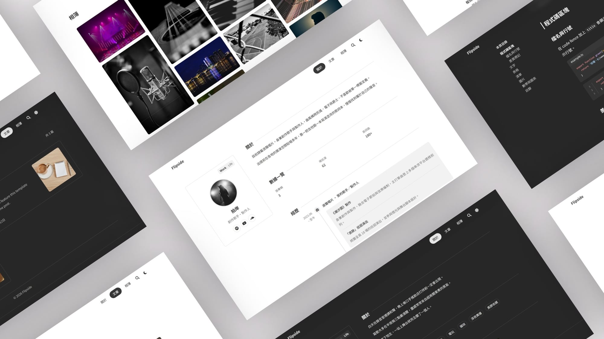
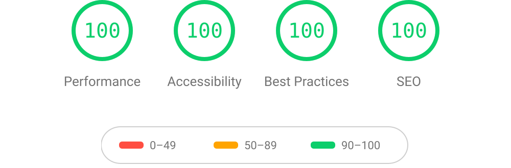

<div align="center">
  <h1>Flipside</h1>
  <p>
    <a href="https://github.com/nagameTW/astro-flipside/actions/workflows/ci.yml"></a>
    <a href="./LICENSE"></a>
    
  </p>
  <p><a href="README.md">繁體中文</a> | <a href="docs/README.en.md">English</a></p>
</div>

Flipside 是 [Astro](https://astro.build/) 的個人網頁與部落格範本。網頁有 Work 與 Life 兩個面向，訪客可以切換，從不同角度認識同一個人。

介面預設為繁體中文，也提供英文，排版對中文友善。輸出為靜態檔案，內建文章、專案、相簿、標籤、RSS 與全文搜尋，可部署到 GitHub Pages、Vercel 等平台。範本源自作者的個人網站，示範內容為虛構。可以先瀏覽[線上示範](https://astro-flipside.vercel.app/)。

另使用以下套件：

- [Tocas UI](https://tocas-ui.com/)：為中文設計的 UI 框架
- [Expressive Code](https://expressive-code.com/)：程式碼區塊
- [Pagefind](https://pagefind.app/)：純靜態全文搜尋

<p align="center">
  
</p>

<details>
  <summary>Lighthouse 行動裝置分數</summary>
  <p align="center">
    <a href="https://pagespeed.web.dev/analysis?url=https%3A%2F%2Fastro-flipside.vercel.app%2F&form_factor=mobile">
      
    </a>
  </p>
</details>

## 需求

- Node.js 22.12 或更新版本

## 快速開始

**1. 建立 repo**

選取 GitHub 頁面上方的 **Use this template**，或執行：

```bash
gh repo create my-flipside --template nagameTW/astro-flipside --public --clone
```

**2. 在本機執行**

```bash
cd my-flipside
npm install
npm run dev     # 開啟 http://localhost:4321，存檔後即時更新
```

**3. 設定網址**

編輯 `src/config.ts` 最上方的兩個欄位。第一欄填網址，例如 `https://<帳號>.github.io`。第二欄 `base` 填 repo 子路徑。若 repo 名稱為 `<帳號>.github.io`，`base` 留空字串。

```ts
base: "/my-flipside",
```

**4. 開啟 GitHub Pages**

到 repo 的 **Settings → Pages**，將 **Source** 設為 **GitHub Actions**。只需設定一次。

**5. 部署**

```bash
git add -A
git commit -m "first deploy"
git push        # Actions 自動建置，約一分鐘後上線
```

之後每次推送到 `main` 都會自動重新部署。若網頁沒有樣式或圖片，檢查 `base`。

## 文件

- [關於 Flipside](docs/about.md)：設計理念
- [新增內容](docs/adding-content.md)：文章、專案、相簿
- [部署](docs/deploy.md)：GitHub Pages 與 Vercel 的設定，其他平台
- [CONTRIBUTING.md](CONTRIBUTING.md)：開發環境與慣例

## 指令

在專案根目錄執行：

| 指令              | 說明                                         |
| :---------------- | :------------------------------------------- |
| `npm run dev`     | 在 `localhost:4321` 啟動本機開發伺服器       |
| `npm run build`   | 建置正式版到 `dist/`，再用 Pagefind 建立索引 |
| `npm run preview` | 在本機預覽正式版建置結果                     |
| `npm run check`   | 對專案做型別檢查                             |
| `npm test`        | 執行 `plugins/*.test.mjs` 的單元測試         |
| `npm run fmt`     | 用 Prettier 格式化程式碼                     |

## 介面語言

預設為 `"zh-TW"`。若要改成英文，將 `src/config.ts` 的 `locale` 設為 `"en"`。字典放在 `src/locales/`。若要新增語言，複製 `en.ts` 的 key 後填入翻譯。

## 專案結構

```
├── src/
│   ├── components/    # Astro 元件：Navbar、Footer、FaceToggle、blocks/ 等
│   ├── content/blog/  # ← 部落格文章（.md / .mdx）
│   ├── data/          # ← 關於與 Life 頁內容、相簿、作品集、獎盃牆
│   ├── layouts/       # Layout.astro、BlogPost.astro
│   ├── locales/       # en.ts 與 zh-TW.ts 介面字串字典
│   ├── pages/         # 路由：首頁、關於、部落格、標籤、相簿、專案、RSS
│   ├── styles/        # global.css
│   ├── utils/         # 文章、時間軸、URL、對話框工具函式
│   └── config.ts      # ← 網站設定的唯一來源
├── plugins/           # 建置期 remark 與 rehype 外掛，附單元測試
├── docs/
│   ├── about.md           # 關於 Flipside
│   ├── adding-content.md  # 新增文章、專案、相簿
│   ├── deploy.md          # 部署設定
│   ├── *.en.md            # 各文件的英文版
│   └── README.en.md       # English README
├── CONTRIBUTING.md    # 如何貢獻
└── SECURITY.md        # 安全政策
```

標示箭頭的位置是架設新網站時要編輯的內容。

## 參與貢獻

歡迎 issue 與 PR。回報問題與功能建議請用 [issue 表單](../../issues/new/choose)。小修正可以開 PR。大改動請先開 issue 討論方向。詳見 [CONTRIBUTING.md](CONTRIBUTING.md)。

## 授權

[MIT](LICENSE)

## 致謝

底層是 [Tocas UI](https://tocas-ui.com/)。部落格骨架依循 Astro 官方 blog starter。
